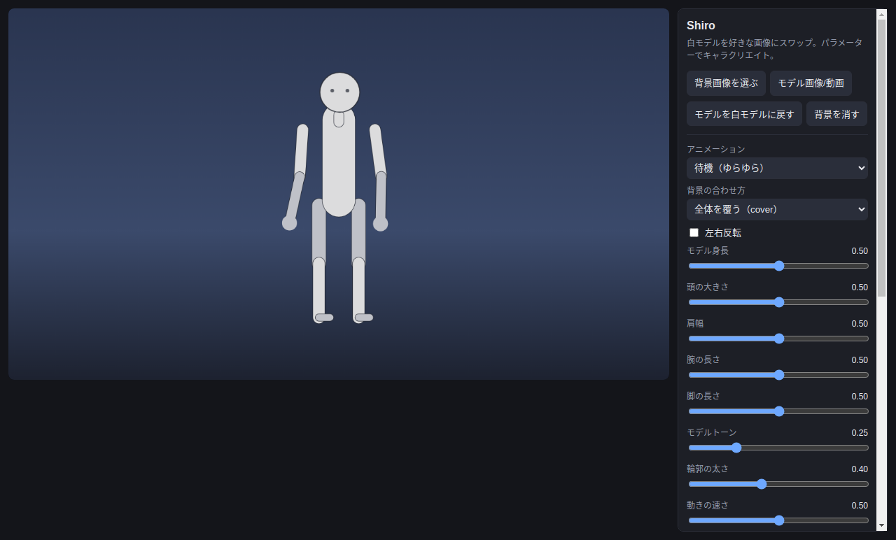

# Shiro

白モデル（内蔵の手続きマネキン、または自分の画像・動画素材）を、好きな背景画像にスワップ合成するキャラクタークリエイト風アプリ。正規の配布形態はデスクトップアプリ（Windows / macOS / Linux）です。アプリ本体は依存ゼロ・ビルド不要の静的ページで、デスクトップアプリはそれを最小の Electron 殻で包んだものです。

Version: 0.1.0



## English

Shiro is a character-creator-style app that composites a white model — the built-in procedural mannequin, or your own image/video material — onto any background image you like. Its canonical form is a desktop app (Windows / macOS / Linux). The app itself is a static page with zero dependencies and no build step; the desktop app wraps that page in a minimal Electron shell.

### Desktop app (canonical form)

The desktop app is a minimal Electron shell around the unchanged page: the page gets no Node.js access (context isolation on, Node integration off, sandbox on, no preload script), and navigating away from the app page or opening new windows is refused.

- Windows: portable `.exe` (no installer) · macOS: `.zip` · Linux: `.AppImage`
- The builds are **unsigned**, so Windows SmartScreen and macOS Gatekeeper may warn on first launch. On Windows choose "More info" → "Run anyway"; on macOS right-click the app → "Open" (or allow it in System Settings → Privacy & Security). On Linux, make the AppImage executable (`chmod +x`).
- Share links created in the desktop app point at the local `file://` page, so they open only on the same machine. To move a work to another device, send the saved PNG instead: "Open work PNG" restores it on any machine (see Work PNG below).
- Favorites work the same as in the browser version (save, export, import from JSON). The favorite name is entered in an in-page dialog, not `prompt()`, which Electron does not support.

Run from source (Node.js required; Electron is a dev dependency only):

```sh
npm install
npm start          # launch the desktop app
npm run dist       # build for the current OS into dist/
```

### Browser version

Just open `index.html` in a browser. No local server is needed, and the app makes no external network requests.

Served over HTTP(S) instead, Shiro is an installable PWA: it can be added to a phone or desktop home screen like an app, and after the first visit it launches offline. The Service Worker caches only the app shell (page, script, manifest, icons) and always fetches network-first, so a new version is never masked by a stale cache. Opening the file directly keeps working exactly as before, just without installation and offline launch.

### Features

- **Choose a background image** — load any image as the composite backdrop (cover / contain fit toggle)
- **Shader backgrounds (from AQUA)** — animated WebGL shader backdrops (Aqua Flow, Aurora, Chromatic Plasma, Ripple, Crystal Voronoi) with per-shader parameter sliders, a 6-colour palette, speed control and play/pause; the choice is remembered in the browser, and shaders are included in PNG / video / share output
- **Choose a model image/video** — replace the white model with your own material; common video formats such as mp4 / webm / mov are supported, and the "white keying strength" slider removes white backgrounds via chroma keying
- **Parameters** — adjust height, head, shoulder width, arms, legs, tone, outline, motion, position, scale, and opacity with sliders, game character-creator style
- **Animation** — idle / wave / walk / dance / still
- **Random** — generate all body parameters at once with a seeded random generator
- **Favorites** — save named presets with thumbnails in the browser (localStorage); export/import as JSON
- **Output** — save as PNG, save a 5-second video (MP4 preferred, WebM fallback), or share directly to external apps via the Web Share API (falls back to PNG download where unsupported)
- **Work PNG (editable output)** — every PNG written by "Save PNG" or "Share" also carries the work state (character parameters + shader background settings) in a PNG `tEXt` chunk (keyword `shiro`, same payload as the share link). "Open work PNG" restores that state ready to edit, on any device, desktop or browser. The image itself is unchanged and opens in any viewer; background images and model material are not stored. Services that re-encode uploaded images may strip the chunk, so send the file itself (USB, your own cloud drive, file attachment). A PNG without the chunk is refused with a message, and the payload goes through the same validation and clamping as a share link
- **Share link** — "Create share link" embeds the current work state (character parameters + shader background settings) in the URL fragment (`#s=…`, base64url, max 2,000 characters). Fragments are never sent to a server, so the state travels only between devices via the link itself. Opening the link restores the work ready to edit — the recipient can adjust it and re-share their own version. Background images and model material are **not** included in the link (they never leave your device); a link that is too long is refused rather than truncated, and a corrupted link shows an error and falls back to the default state
- **Installable / offline (PWA)** — when served over HTTP(S), Shiro installs like an app (manifest + icons) and launches offline after the first visit; the Service Worker caches the app shell only, never your images, videos, or favorites

Everything stays local: no external keys, network access, or tracking. Images, videos, and favorites never leave your device.

Tests: `node test.mjs` (836 assertions).

---

## デスクトップアプリ（正規形態）

デスクトップアプリは、アプリ本体（変更なし）を包む最小の Electron 殻です。ページには Node.js の権限を一切与えず（contextIsolation 有効・nodeIntegration 無効・sandbox 有効・preload なし）、アプリ外へのナビゲーションと新規ウィンドウは禁止しています。

- Windows: portable `.exe`（インストール不要）／ macOS: `.zip` ／ Linux: `.AppImage`
- **未署名**のため、初回起動時に Windows SmartScreen や macOS Gatekeeper の警告が出ることがあります。Windows は「詳細情報」→「実行」、macOS はアプリを右クリック→「開く」（または システム設定 → プライバシーとセキュリティ で許可）。Linux は AppImage に実行権限（`chmod +x`）を付けてください
- デスクトップアプリで作った共有リンクはローカルの `file://` ページを指すため、同じ PC でしか開けません。他の端末へ作品を移すときは、保存した PNG を送って「作品PNGを開く」で開いてください（下記「作品PNG」）
- お気に入り（保存・書き出し・JSON からの読み込み）はブラウザ版と同じく使えます。名前はページ内のダイアログで入力します（Electron がサポートしていない `prompt()` は使いません）

ソースから起動・ビルド（Node.js が必要。Electron は開発用依存のみ）:

```sh
npm install
npm start          # デスクトップアプリを起動
npm run dist       # 現在の OS 向けに dist/ へビルド
```

## ブラウザ版の使い方

`index.html` をブラウザで開くだけ。ローカルサーバー不要、外部通信なし。

HTTP(S) で配信した場合は PWA としてインストールもできます。ホーム画面に追加してアプリのように起動でき、初回アクセス後はオフラインでも開けます。Service Worker がキャッシュするのはアプリ本体（ページ・スクリプト・マニフェスト・アイコン）だけで、取得はネットワーク優先のため新しい版が古いキャッシュに隠れることはありません。ファイルを直接開く従来の使い方もそのまま使えます（その場合はインストールとオフライン起動だけが無効です）。

- **背景画像を選ぶ** — 合成先の好きな画像を読み込み（cover / contain 切替）
- **背景シェーダー（AQUA 由来）** — WebGL シェーダーの動く背景（Aqua Flow、Aurora、Chromatic Plasma、Ripple、Crystal Voronoi）。シェーダーごとのパラメータースライダー、基調色6色、速さ調整、再生/一時停止つき。選択はブラウザに保存され、PNG・動画・共有の書き出しにも背景が含まれます
- **モデル画像/動画を選ぶ** — 自分の素材で白モデルを差し替え。mp4 / webm / mov 等の通常動画形式に対応。「白抜き強度」で白背景をクロマキー除去
- **パラメーター** — 身長・頭・肩幅・腕・脚・トーン・輪郭・動き・位置・倍率・不透明度をスライダーで調整（ゲームのキャラクリエイト感覚）
- **アニメーション** — 待機 / 手を振る / 歩く / ダンス / 静止
- **ランダム** — 全身パラメーターをシード付き乱数で一括生成
- **お気に入り** — 名前付きプリセットをサムネイル付きでブラウザ(localStorage)に保存。JSON で書き出し/読み込み可能
- **出力** — PNG 保存、動画保存（5秒: MP4 優先・非対応時は WebM）、共有ボタンで外部アプリへ直接送受信（Web Share API、非対応環境は PNG ダウンロードにフォールバック）
- **作品PNG（開き直せる書き出し）** — 「PNG保存」「共有（外部アプリ）」で書き出す PNG には、作品状態（キャラのパラメーター＋背景シェーダーの設定）が PNG の `tEXt` チャンク（キーワード `shiro`、共有リンクと同じペイロード）として入ります。「作品PNGを開く」でその PNG を選ぶと、デスクトップ版・ブラウザ版のどちらでも、別の端末でも、そのまま編集を再開できます。画像そのものは変わらず普通の PNG として開けます。背景画像・モデル素材は入りません。アップロード時に画像を再圧縮するサービスではチャンクが消えることがあるため、ファイルそのもの（USB・自分のクラウドドライブ・添付）で送ってください。作品情報のない PNG は案内を出して読み込まず、ペイロードは共有リンクと同じ検証・クランプを通します
- **共有リンク** — 「共有リンクを作る」で作品状態（キャラのパラメーター＋背景シェーダーの設定）を URL のフラグメント（`#s=…`、base64url、上限2,000文字）に埋め込んだリンクを作成。フラグメントはサーバーへ送られないため、状態はリンク経由で端末間だけを移動します。リンクを開くと作品が復元され、そのまま編集して自分の作品として再共有できます。背景画像・モデル素材はリンクに**含まれません**。長すぎるリンクは切り捨てず生成を拒否し、壊れたリンクはエラーを表示して既定の状態で起動します
- **インストール／オフライン（PWA）** — HTTP(S) 配信時はアプリとしてインストールでき、初回アクセス後はオフラインでも起動。Service Worker のキャッシュ対象はアプリ本体のみで、素材・お気に入りは対象外です

## 構成

| ファイル | 役割 |
|---|---|
| `index.html` | UI（キャンバス + パラメータパネル + お気に入りバー） |
| `app.js` | 全ロジック。純粋関数は `ShiroLib` に集約（RNG・パラメータ検証・プリセット・クロマキー・骨格・描画） |
| `manifest.webmanifest` | PWA マニフェスト（名前・アイコン・テーマ色・表示モード）。HTTP(S) 配信時のみ有効 |
| `sw.js` | Service Worker（アプリ本体のキャッシュとオフライン起動）。登録は http(s) 配信時のみで、file:// では従来どおり動く |
| `icon-192.png` / `icon-512.png` / `icon-512-maskable.png` | アプリアイコン（白モデルの図形を生成したもの） |
| `test.mjs` | `node test.mjs` で純粋ロジックと UI 起動を検証するテストゲート |
| `desktop/main.js` | デスクトップアプリの Electron 殻（ウィンドウでアプリ本体を表示するだけ。本体には触れない） |
| `package.json` | Electron / electron-builder（版数固定の開発用依存）とビルド設定（Windows=portable exe、macOS=zip、Linux=AppImage） |

## テスト

```sh
node test.mjs   # 836 assertions
```

## 設計メモ

- マネキンは関節スケルトン（脚2関節×2、腕2関節×2、頭・胴）を正規化空間で計算し、capsule 描画。アニメーションは時間 t の決定論的関数なので録画とプレビューが一致する
- 動画素材の白抜きはフレーム毎に per-pixel アルファ適用（処理幅 960px にキャップ）。静止画はパラメータ変更時のみ再処理
- 外部キー/ネットワーク/トラッキングなし。画像・動画・お気に入りは全てローカルに留まる
- 共有リンクの直列化は、お気に入りと同じ既存のプリセット形式（`{v:1, name, params}`）を再利用し、シェーダー状態を同じ JSON に相乗りさせている。受け取ったリンクは他者からの入力として扱い、デコード時に版数確認・パラメーターのクランプ・シェーダー ID の許可リスト照合・シェーダーパラメーターの範囲クランプを全て行う
- PWA の Service Worker はアプリ本体（シェル）だけをキャッシュする。取得はネットワーク優先（在線時は常に最新、オフライン時のみキャッシュ）、キャッシュ名には版数を持ち activate で旧版を全て消すため、新版が古いキャッシュに固着しない。ユーザーの素材・お気に入りはキャッシュ対象外

## ライセンス

MIT License — 詳細は [LICENSE](./LICENSE) を参照。
